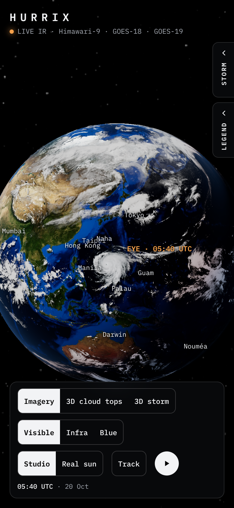

# Hurrix

**Tropical cyclones on a 3D globe, from real satellite imagery.**


Hurrix takes the pictures that weather satellites send down every ten minutes and puts them on a globe you can spin. It finds the hurricanes and typhoons in those pictures by itself, follows each one back over the last two days, and lets you fly in and see the storm in 3D.

Nothing on the globe is drawn by hand. Every cloud you see is a pixel the satellite measured. The only modelled parts are the heights in the 3D views, which come from the cloud temperatures (see [how the 3D views work](docs/spec.md#8-the-3d-views)).

For the full story (every data source, the pipeline step by step, how the 3D views are built, and the libraries), read **[How Hurrix works](docs/spec.md)**. It's written for learners and developers, with a glossary for the jargon.

## What you see

There are three views, picked from the bar at the bottom of the screen.

| View | What it shows |
| --- | --- |
| **Imagery** | The whole Earth as the satellites see it right now. Around the selected storm, a sharper close-up is laid on top: a true-colour photo (1 km per pixel) if it was daytime there, otherwise an infrared picture (2 km per pixel). |
| **3D cloud tops** | The storm's close-up with every pixel lifted to the height of its cloud top, so the tall thunderstorms around the eye stand up like mountains. |
| **3D storm** | The same storm as a soft, see-through 3D cloud you can fly around, lit by the sun. |


There are also three ways to colour the clouds:

- **Visible** shows real colour, the way your eyes would see it from space. It only works in daylight, so the night side falls back to infrared in grey.
- **Infra** colours the clouds by temperature, like the weather maps on TV. Warm, low clouds are grey. Below −30 °C they run from blue through green, yellow and red to deep red at −75 °C. The colder the top, the higher and stronger the storm.
- **Blue** shows infrared clouds over a deep blue sea, which makes the storm's shape easy to read.

A few more controls:

- **Lighting:** *Studio* uses a fixed light that shows the 3D shapes clearly. *Real sun* puts the sun where it really was at the frame time, so half the globe is in night.
- **Track:** draws each storm's path over the last 48 hours. It's off at first.
- **Play:** runs the last 3 hours in 10-minute steps, using the real satellite frames.
- **Storm and Legend:** two tabs on the right edge. Each opens a panel (the storm's details, or what the colours mean) that slides back out of the way by itself.

On a phone the same page fits a portrait screen, with the panels as drawers on the right edge:



## How it works, in short

```
NOAA satellite files ──► pipeline/ (Python) ──► public/data/ (images + JSON) ──► the page (three.js)
```

- **Data:** infrared and visible pictures from three weather satellites, GOES-19, GOES-18 and Himawari-9, downloaded from [NOAA's open data on AWS](https://registry.opendata.aws/noaa-goes/). No account or key needed. The Earth underneath is NASA's Blue Marble.
- **Pipeline:** Python scripts stitch the satellites into one world map, find the storms by their cold cloud cores, follow each one back 48 hours, and cut a sharp close-up and a 3-hour loop for each.
- **Page:** a static TypeScript site that draws everything with [three.js](https://threejs.org) and WebGL shaders, built with [Vite](https://vite.dev).
- **3D:** cloud heights come from cloud-top temperatures (the air cools about 6.3 °C per km), so the 3D shapes are modelled from real measurements.

Hurrix isn't an official forecast. The intensity is a rough, unofficial estimate, storm names and advisories aren't wired in yet, and Europe, Africa and the Indian Ocean show archive clouds because Meteosat isn't on NOAA's buckets. [Section 11 of the spec](docs/spec.md#11-limits) has the details.

## Run it

You need Node.js 20.19 or newer.

```sh
npm install
npm run dev        # http://localhost:5173
npm run build      # type-check and build the static site into dist/
```

## Refresh the satellite frame

`public/data` holds one saved frame. To replace it with the latest one you need Python 3:

```sh
python3 -m pip install -r pipeline/requirements.txt
npm run data                          # the slot 40 minutes ago
sh pipeline/run.sh 2026-10-20T05:40   # or a given 10-minute slot (UTC)
```

The downloads are large (a GOES full-disk visible file is about 200 MB), so the first run takes a while. Downloaded files are cached in `pipeline/frames`.

## Project layout

```
src/main.ts        start-up: loads the data, builds the globe, binds the controls
src/meta.ts        the frame and its storms, formatting, the intensity estimate, where the sun is
src/hdr/scene.ts   the three.js scene: HDR pipeline, Earth, clouds, atmosphere, track, imagery patch, 3D views, camera
src/hdr/glsl.ts    the shaders
src/ui.ts          buttons, panels, legend, loop player and labels
src/style.css      the page's look
pipeline/          the Python data refresh (see above)
public/data/       the saved frame the page loads
public/textures/   Earth and sky textures (three-globe examples, MIT; NASA Blue and Black Marble)
```

The full reference is [docs/spec.md](docs/spec.md); early design notes are in `docs/superpowers/specs/`. Licences are in `public/third-party-notices.txt` (`npm run notices` regenerates it).
