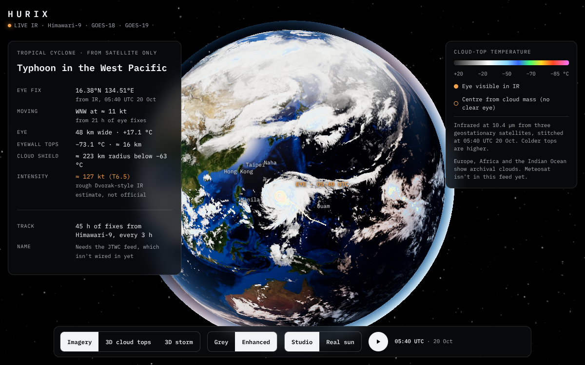
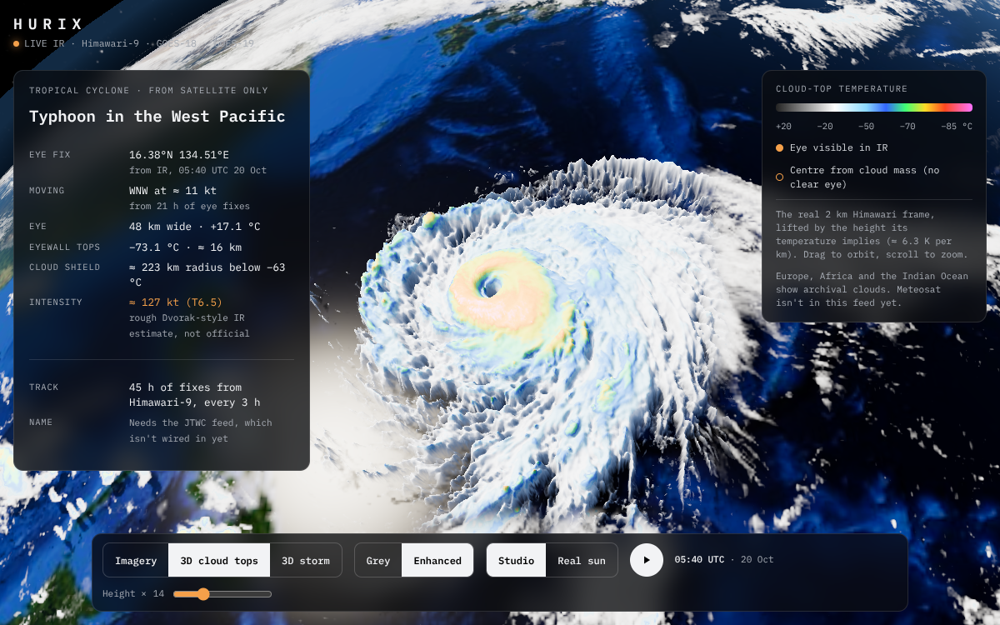
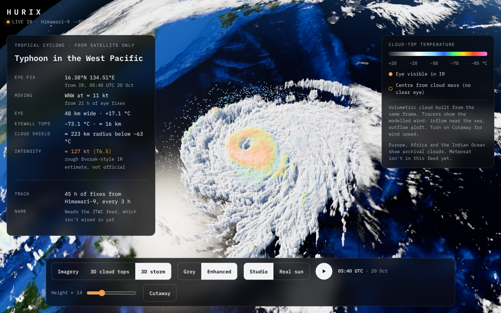

# Hurix

**Tropical cyclones on a 3D globe, from real satellite imagery.**



Hurix shows the live infrared view of the Earth from three geostationary satellites (Himawari-9, GOES-18 and GOES-19), stitched into one cloud layer over a Blue Marble globe. It picks out the strongest storm, tracks its eye back 48 hours, and lets you switch the storm into 3D.

| View | What it shows |
| --- | --- |
| **Imagery** | The stitched 10.4 µm infrared on the globe, with the eye track. Enhanced colours mark the coldest, highest tops. |
| **3D cloud tops** | The storm's own 2 km frame, each pixel lifted to the height its temperature implies (about 6.3 K per km). |
| **3D storm** | A volumetric cloud built from the same frame, with wind tracers from a Holland wind profile and a wind-speed cutaway. |




A 3-hour loop at 10-minute steps plays the real frames. Lighting can follow the real sun at the frame time, or a studio key light.

## Honesty

- Intensity is a rough Dvorak-style estimate from the eye and eyewall temperatures, and is labelled as unofficial.
- The storm's name and official advisories need the JTWC or NHC feeds, which aren't wired in yet.
- Meteosat isn't on NOAA's open buckets, so Europe, Africa and the Indian Ocean show archival clouds. The legend says so.

## Run it

```sh
npm install
npm run dev        # http://localhost:5173
npm run build      # type-check and build the static site into dist/
```

## Refresh the satellite frame

`public/data` holds one baked frame. To replace it with the latest one:

```sh
python3 -m pip install -r pipeline/requirements.txt
npm run data                          # the slot 40 minutes ago
sh pipeline/run.sh 2026-10-20T05:40   # or a given 10-minute slot (UTC)
```

The pipeline reads NOAA's open data on AWS (no account needed) and writes `public/data`:

- `fetch.sh` downloads GOES-19/18 band 13 and cloud-top height, and the Himawari-9 band 13 tiles.
- `reproject.py` maps each satellite's disc onto one equirectangular grid, preferring the satellite with the best view and blending the seams.
- `storm.py` finds the eye (a warm spot ringed by the coldest tops) and tracks it back every 3 hours. When the eye is clouded over it uses the centre of the cold cloud mass, and marks that fix.
- `export.py` writes the textures, the loop and `meta.json`.

The current pipeline follows one storm in the Himawari-9 view.

## Layout

```
src/main.ts        start-up
src/meta.ts        the frame's measurements, formatting, the Dvorak-style estimate, the subsolar point
src/hdr/scene.ts   three.js scene: HDR pipeline with ACES and bloom, Earth, clouds, atmosphere, track, 3D views
src/hdr/glsl.ts    shaders
src/ui.ts          card, legend, controls, loop and labels
pipeline/          the data refresh
public/textures/   Earth textures (three-globe examples, MIT; NASA Blue and Black Marble)
```

Design notes are in `docs/superpowers/specs/`. Licences are in `public/third-party-notices.txt` (`npm run notices` regenerates it).
